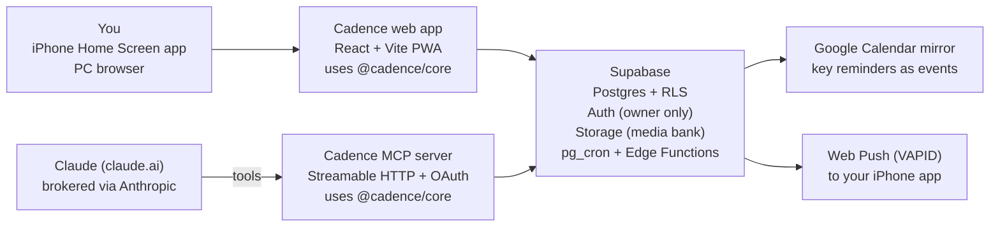

# Cadence: SRS + Test-Driven Implementation Plan

Version: 2026-10-15

## 1. Introduction

Cadence is a single-user, mobile-first web app that runs one person's social media system: it holds every post from idea to published, enforces a set of balance and habit rules, sends reminders at each stage, and exposes an MCP connector so Claude (in claude.ai) can read the data and propose posts.

**Source of truth for strategy:** `docs/strategy.md`. This SRS turns that plan into testable requirements. Where they disagree, this SRS wins for the software; the strategy doc wins for content decisions.

**Scope (MVP):** post pipeline, calendar, approval inbox, balance engine, media bank, idea pool, reminders (web push + Google Calendar mirror), weekly report, check-ins, follower snapshots, milestones and strategy triggers, MCP connector, settings, export.

**Glossary**

| Term | Meaning |
| --- | --- |
| Owner | The single human user of the app |
| Post | One content idea that ships to one or more platforms |
| Variant | A post's version for one platform (caption, format, schedule, metrics) |
| Pillar | Content category: life_style, student_life, pov_journey, work_lessons |
| Topic tag | ai, uiux, gamedev, ar, accessibility |
| Stage | A post's status in the lifecycle (idea → reviewed) |
| Batch night | Weekly Friday-night session to plan, edit, write and schedule |
| Check-in | A prompt to log a variant's metrics N days after it went live |
| Trigger | A rule that flags the need for an early strategy review |
| Connector | The Cadence MCP server, added to claude.ai as a custom connector |
| Local time | Africa/Algiers (UTC+1, no DST) unless Settings says otherwise |

Requirement keywords follow RFC 2119: MUST, SHOULD, MAY.

## 2. Overall description

Cadence is three deployables sharing one database and one pure domain library (`@cadence/core`): the web app, the MCP server, and scheduled Edge Functions for reminders.



All business rules (balance, reminders, triggers, reports) live in `@cadence/core` so they are tested once and behave identically in the app, the connector and the scheduler.

**Actors**

| Actor | Can do |
| --- | --- |
| Owner | Everything, from iPhone or PC |
| Claude (via connector) | Read all data; create ideas, posts and milestones; update posts and verdicts; never delete; new posts always start as Proposed |
| Scheduler | Compute and send reminders, mirror calendar events, evaluate triggers |

**Constraints**

- **Connector:** claude.ai custom connectors call remote MCP servers from Anthropic's cloud, over Streamable HTTP, with authless or OAuth auth. Cadence MUST use OAuth and allow Claude's callback URLs (`https://claude.ai/api/mcp/auth_callback` and `https://claude.com/api/mcp/auth_callback`). See https://support.claude.com/en/articles/11503834-building-custom-connectors-via-remote-mcp-servers. The server MUST be on public HTTPS.
- **iPhone push:** web push needs iOS 16.4+, the app added to the Home Screen and opened from there, and a permission prompt triggered by a tap. See https://pushpad.xyz/blog/ios-special-requirements-for-web-push-notifications.
- **No platform APIs in MVP:** no posting to or reading from Instagram, TikTok or LinkedIn; metrics are typed in by the owner.
- **Single user:** one owner account; every table is protected by row-level security on owner_id.
- **Time:** all scheduling in the owner's timezone (default Africa/Algiers); stored as UTC timestamps.

**Assumptions**

- The owner's Claude plan includes custom connectors.
- The owner has a Google account for the calendar mirror.
- UI language is English; content language is tracked per variant (en, darija, mixed).

## 3. Functional requirements

Each requirement has an ID that tests reference (e.g. `it('FR-2: rejects capture → posted')`). A planning week runs Saturday 00:00 to Friday 23:59 local time.

### 3.1 Posts and pipeline

| ID | Requirement | Acceptance criteria |
| --- | --- | --- |
| FR-1 | The system MUST create posts with title, pillar, topics, goLiveAt and notes | Owner-created posts start as `idea`; Claude-created posts start as `proposed` with createdBy = claude |
| FR-2 | Stages MUST be: idea, proposed, approved, capture, edit, write, scheduled, posted, replied, reviewed, plus archived | Forward moves one step only; backward moves to any earlier stage; archive from any stage; capture → posted is rejected; posted → edit is allowed |
| FR-3 | The owner MUST be able to edit every post and variant field, including dates, on phone and PC | Every change appends to changeLog with actor, field, old value, new value and timestamp |
| FR-4 | Each post MUST support one variant per platform | Allowed formats: Instagram reel, carousel, photo, story; TikTok video, photo; LinkedIn text, image, document, video. A LinkedIn reel is rejected |
| FR-5 | Marking a variant posted MUST set postedAt, start the reply timer and create check-ins | Check-ins at day 3 and 7 for all platforms, plus day 14 for TikTok |

### 3.2 Calendar and approval

| ID | Requirement | Acceptance criteria |
| --- | --- | --- |
| FR-6 | The app MUST show a week view (Saturday–Friday) and a list view of variants by scheduled or go-live time | Changing a date takes at most 2 taps from the calendar item; times show in the owner's timezone |
| FR-7 | The app MUST provide an approval inbox for proposed posts | Each item shows balance warnings; approve → approved; reject → archived with a reason; edit opens the post |

### 3.3 Balance, ideas and media

| ID | Requirement | Acceptance criteria |
| --- | --- | --- |
| FR-8 | The balance checker MUST evaluate rules R1–R8 (section 4.1) for a date window, with or without a hypothetical post | Returns warnings with rule ID, message and severity; shown in post editor, inbox and weekly report |
| FR-9 | The owner MUST be able to add an idea in 3 taps or fewer from the home screen, on phone or PC | Source (phone, pc, chat) is recorded |
| FR-10 | The system MUST store Claude's idea verdicts | Five scores of 1–3; verdict computed by core, not trusted from input: total ≥ 11 → go, 8–10 → improve, < 8 → bank; notes and at least one alternative required |
| FR-11 | An idea MUST be promotable to a post | The post links back to the idea; idea status becomes promoted |
| FR-12 | The owner MUST be able to upload photos and videos from phone or PC into a media bank | Tags, links to posts, a "not yet used" filter; files above the configured limit (default 100 MB) are rejected with a clear message |

### 3.4 Reminders and notifications

| ID | Requirement | Acceptance criteria |
| --- | --- | --- |
| FR-13 | The system MUST generate reminders per section 4.2 | Defaults editable globally and per post; non-urgent reminders inside quiet hours (default 23:30–08:00) move to the end of quiet hours |
| FR-14 | Reminders MUST be delivered by Web Push to every subscribed device | Tapping a notification opens the related screen; failed deliveries are retried once and logged |
| FR-15 | Batch night, weekly report and milestone reminders MUST be mirrored to Google Calendar | Event create/update/delete is idempotent, keyed by reminder ID |
| FR-16 | A reply timer (default 15 min) MUST start when a variant goes live | Notifications at start and end; the timer is visible in the app |

### 3.5 Weekly loop, metrics and milestones

| ID | Requirement | Acceptance criteria |
| --- | --- | --- |
| FR-17 | Every Friday at the report time (default 20:00) the system MUST generate a weekly report for the current planning week | Contains planned vs done per platform, missed items, balance warnings, LinkedIn captured (yes/no), check-ins done and overdue, follower snapshot status; the report is immutable except readyForClaudeAt |
| FR-18 | "Report to Claude" MUST set readyForClaudeAt | Claude can fetch the report through the connector |
| FR-19 | The owner MUST be able to log metrics for each check-in | Due and overdue check-ins are listed; a check-in is done when its metrics are saved |
| FR-20 | The owner MUST be able to log weekly follower counts for each platform | History is shown as a line chart per platform |
| FR-21 | Milestones MUST be seeded relative to the first scheduled post | Weeks 1, 2, 4, 6 and 10, plus a research refresh every 13 weeks; each stores outcome and decision |
| FR-22 | Strategy triggers T1–T4 (section 4.3) MUST be evaluated daily | A fired trigger creates a Trigger record and a notification; the owner or Claude resolves it |
| FR-23 | LinkedIn capture MUST be prompted weekly | Monday 18:00 reminder; if no item tagged linkedin-capture exists since Saturday 00:00, a Tuesday 21:00 fallback suggests a reflection post |

### 3.6 Settings, access and connector

| ID | Requirement | Acceptance criteria |
| --- | --- | --- |
| FR-24 | The owner MUST be able to edit settings | Timezone, batch night time, report time, reply window, quiet hours, phase, check-in offsets, rule parameters |
| FR-25 | Changing phase MUST change rule targets | Phase 1 and Phase 2 targets per section 4.1 |
| FR-26 | Only the owner MUST be able to sign in | Email magic link; a second sign-up is rejected; the MCP OAuth consent uses the same identity |
| FR-27 | The owner MUST be able to export all data | JSON of every table plus signed media URLs |
| FR-28 | The MCP server MUST expose the tools in section 6 | Contract tests pass for every tool |

## 4. Rule specifications

These rules live in `@cadence/core` as pure functions of (data, settings, now). Every rule takes an injected clock and timezone; none reads the system time.

### 4.1 Balance rules

Counted items are variants with status approved or later (not archived), placed by goLiveAt. "Personal" means Instagram + TikTok. Severity is info, warning or error; error asks for confirmation before approval but never blocks the owner.

| ID | Rule | Window | Fires when | Severity |
| --- | --- | --- | --- | --- |
| R1 | Personal pillar mix matches phase targets (counted on Instagram variants). Phase 1: life_style 5, student_life 2, pov_journey 1. Phase 2: 7, 3, 2 | Rolling 28 days | A pillar is off target by 1 (info) or 2+ (warning); any work_lessons variant on a personal platform while settings.workOnPersonal = false (error) | info / warning / error |
| R2 | No same pillar twice in a row on one platform | All, ordered by goLiveAt | Two adjacent variants on one platform share a pillar | warning |
| R3 | LinkedIn topic coverage | 42 days (all topics), 28 days (accessibility) | A topic tag has no LinkedIn variant in its window | warning |
| R4 | Every platform posts every planning week | Planning week | A platform has 0 variants in the week | warning |
| R5 | LinkedIn stays professional | Per variant | A LinkedIn variant's post pillar is not work_lessons or pov_journey | error |
| R6 | Instagram weekly mix and volume | Planning week | Fewer than 1 reel or 1 carousel; or fewer posts than the phase target (Phase 1: 2, Phase 2: 3) | warning |
| R7 | Reuse: Instagram and TikTok are paired | Per post | A post has a non-story Instagram variant but no TikTok variant, or the reverse | info |
| R8 | Leftovers cap | Planning week | More than 1 post with isLeftovers = true | warning |

### 4.2 Reminder schedule

All times local. A reminder's key is code + entity ID + date, so regenerating is idempotent. At send time the condition is re-checked; if it no longer holds, the reminder is cancelled. Non-urgent reminders inside quiet hours move to the end of quiet hours; urgent reminders ignore quiet hours.

| Code | When | Condition at send time | Urgent | Calendar mirror |
| --- | --- | --- | --- | --- |
| SHOT_LIST | Sunday 18:00 | Posts going live this week in stage capture or earlier | No | No |
| WEEKLY_REPORT | Friday 20:00 | Always; includes follower snapshot prompt | No | Yes |
| BATCH_NIGHT | Friday 20:15 | Always; lists ideas awaiting a verdict | No | Yes |
| SCHEDULE | Friday 22:00 | Approved variants for next week not yet scheduled | No | No |
| POST_NOW | Variant goLiveAt | Variant not scheduled natively and not posted | Yes | No |
| REPLY_START / REPLY_END | goLiveAt / + reply window | Variant posted (Instagram, LinkedIn; TikTok optional) | Yes | No |
| CHECKIN | postedAt + offset days, 20:00 | Check-in not done | No | No |
| MISSED | Day after goLiveAt, 09:00 | Variant still not posted; suggests a leftovers post | No | No |
| LI_CAPTURE | Monday 18:00 | Always | No | No |
| LI_FALLBACK | Tuesday 21:00 | No item tagged linkedin-capture since Saturday 00:00 | No | No |
| MILESTONE | Milestone dueAt, 20:00 | Milestone has no outcome | No | Yes |
| MONTHLY_REVIEW | First Saturday of the month, 11:00 | Always | No | Yes |
| TRIGGER | When a trigger fires | Trigger unresolved | No | No |

### 4.3 Strategy triggers

Evaluated daily at 08:00. A trigger does not fire again for the same rule and platform while one is unresolved.

| ID | Fires when | Data used |
| --- | --- | --- |
| T1 | A platform's weekly reach falls week over week 3 times in a row (needs 4 weeks of data) | Sum of reach from day-7 check-ins of variants posted that week |
| T2 | Completion rate is under 75% for 2 planning weeks in a row | done / planned variants per week, weeks with planned ≥ 1 |
| T3 | Over 28 days, one pillar's mean (sends + saves) per personal variant is at least 2x every other pillar's | Day-7 check-ins; each compared pillar needs ≥ 2 variants |
| T4 | Created manually for a platform policy or algorithm change | Owner or Claude, with a note |

### 4.4 Check-ins

| Platform | Offsets (days after postedAt) | Fields |
| --- | --- | --- |
| Instagram | 3, 7 | views, reach, likes, comments, saves, shares, follows; avgWatchSeconds for reels |
| TikTok | 3, 7, 14 | views, reach, likes, comments, saves, shares, follows, avgWatchSeconds |
| LinkedIn | 3, 7 | views (impressions), reactions as likes, comments, shares, follows |

Offsets are settings. A check-in is overdue 2 days after it is due. Missing fields are stored as null, never zero.

### 4.5 Weekly report

- **Planned:** variants with goLiveAt in the planning week and status approved or later at report time.
- **Done:** planned variants with postedAt set.
- **Missed:** planned variants with goLiveAt before report time and no postedAt.
- **Completion rate:** done / planned, or null when planned = 0.

## 5. Data model

Postgres (Supabase). Every table has `id uuid pk`, `owner_id uuid` (row-level security: owner_id = auth.uid()), `created_at` and `updated_at`. Timestamps are `timestamptz` in UTC; local time is applied in `@cadence/core`.

**Enums**

| Enum | Values |
| --- | --- |
| stage | idea, proposed, approved, capture, edit, write, scheduled, posted, replied, reviewed, archived |
| pillar | life_style, student_life, pov_journey, work_lessons |
| topic | ai, uiux, gamedev, ar, accessibility |
| platform | instagram, tiktok, linkedin |
| format | reel, carousel, photo, story, video, text, image, document |
| language | en, darija, mixed |
| actor | owner, claude, system |
| verdict | go, improve, bank |

**Tables**

| Table | Columns (beyond the common ones) | Constraints |
| --- | --- | --- |
| posts | title text, pillar, topics topic[], status stage, go_live_at, notes text, is_leftovers bool, idea_id → ideas, created_by actor | status default idea; created_by = claude forces status proposed on insert |
| variants | post_id → posts, platform, format, language, caption, hook, hashtags text[], scheduled_at, scheduled_natively bool, posted_at, url | unique (post_id, platform); format allowed for platform (FR-4) |
| change_log | entity_type, entity_id, actor, field, old_value jsonb, new_value jsonb, at | insert-only |
| media | storage_path, kind (photo, video), tags text[], taken_at, size_bytes | size ≤ settings.max_upload_mb |
| post_media, idea_media | post_id or idea_id, media_id | composite pk |
| ideas | text, source (phone, pc, chat), tags text[], pillar, topics topic[], status (new, reviewed, promoted, banked) | |
| idea_verdicts | idea_id → ideas, scores jsonb (forwardable, fills_gap, doable, original, hook: 1–3 each), total int, verdict, notes text, alternatives text[], by actor | total and verdict computed by core; alternatives ≥ 1 |
| checkins | variant_id → variants, day_offset int, due_at, done_at, views, reach, likes, comments, saves, shares, follows, avg_watch_seconds (all int, nullable) | unique (variant_id, day_offset) |
| follower_snapshots | platform, count int, week_start date, taken_at | unique (platform, week_start); count ≥ 0 |
| weekly_reports | week_start date, payload jsonb, generated_at, ready_for_claude_at | unique (week_start); payload immutable |
| milestones | kind (checkpoint, research_refresh), week int, title, checks text[], due_at, outcome text, decision text | |
| triggers | rule (T1–T4), platform, params jsonb, note, fired_at, resolved_at, resolved_by actor | one unresolved per (rule, platform) |
| reminders | code, key text, entity_type, entity_id, send_at, sent_at, cancelled_at, urgent bool, calendar_event_id | unique (key) |
| push_subscriptions | endpoint text, keys jsonb, device_label | unique (endpoint) |
| settings | timezone (default Africa/Algiers), phase int, report_time, batch_time, reply_window_minutes, quiet_start, quiet_end, checkin_offsets jsonb, rule_params jsonb, work_on_personal bool (default false), max_upload_mb (default 100), first_post_at | one row per owner |

**Database roles:** the MCP server connects as role `cadence_mcp` with SELECT, INSERT and UPDATE only, so "Claude never deletes" is enforced by the database, not just by code.

## 6. MCP connector

A remote MCP server over Streamable HTTP, written in TypeScript with the official MCP SDK. Inputs are validated with zod schemas shared from `@cadence/core`. All times in outputs are ISO 8601 with the owner's offset.

### 6.1 Tools

| Tool | Input | Returns | Writes |
| --- | --- | --- | --- |
| get_calendar | from, to (dates) | Variants with post summary, stage, local times | No |
| get_post | id | Post, variants, linked media, change log | No |
| check_balance | from, to, optional hypothetical post | Warnings (rule, severity, message) | No |
| list_ideas | status?, limit? | Ideas with latest verdict | No |
| list_media | tags?, unusedOnly?, limit? | Metadata + short-lived signed thumbnail URLs | No |
| get_weekly_report | weekStart? (default: latest ready) | Report payload | No |
| get_checkins | from, to | Check-ins with metrics | No |
| get_follower_history | platform?, weeks (default 12) | Weekly counts | No |
| get_metrics_summary | month | Totals and means per platform and pillar | No |
| list_milestones / list_triggers | unresolvedOnly? | Milestones / triggers | No |
| get_settings | — | Settings (read-only) | No |
| create_idea | text, pillar?, topics?, tags? | Idea (source = chat) | Yes |
| review_idea | ideaId, scores (5 × 1–3), notes, alternatives (≥ 1) | Stored verdict, computed by core | Yes |
| propose_post | title, pillar, topics, goLiveAt, variants[], ideaId?, isLeftovers?, notes? | Post (status proposed) + balance warnings | Yes |
| update_post / update_variant | id, patch, reason | Updated entity + balance warnings | Yes |
| update_milestone | id, outcome, decision | Milestone | Yes |
| create_trigger / resolve_trigger | T4 + platform + note / id + note | Trigger | Yes |

### 6.2 Safety rules

1. There is no delete tool, and the `cadence_mcp` database role has no DELETE grant.
2. Claude cannot change a post's stage. Owner approval is the only path out of proposed. update_post and update_variant reject `status` and `postedAt` in a patch.
3. Every write logs to change_log with actor = claude and the `reason` given.
4. Write tools are rate-limited (default 60 writes per hour) and return a clear error when the limit is hit.
5. Tools carry MCP annotations: read tools `readOnlyHint: true`; write tools `destructiveHint: false`.
6. Server instructions tell Claude the balance rules, the idea rubric, and the agreed feedback style: direct, always with at least one alternative.

### 6.3 Authentication

- OAuth 2.1 with PKCE, supporting dynamic client registration; claude.ai also accepts a custom client ID and secret if needed.
- Allowed redirect URIs: `https://claude.ai/api/mcp/auth_callback` and `https://claude.com/api/mcp/auth_callback`.
- The authorize page signs in the owner with the same Supabase identity as the web app; nobody else can complete consent.
- Access tokens are short-lived with refresh tokens; the owner can revoke connector access in Settings.

## 7. Non-functional requirements

| ID | Area | Requirement | How it is verified |
| --- | --- | --- | --- |
| NFR-1 | Accessibility | WCAG 2.2 AA across the app | axe-core in every Playwright test with zero violations; manual VoiceOver pass per milestone |
| NFR-2 | Mobile | Every flow usable one-handed on a 390 px wide iPhone screen; touch targets ≥ 44 px | Playwright on an iPhone viewport (WebKit) |
| NFR-3 | Installable | Valid web app manifest and service worker; installs to the iPhone Home Screen | Lighthouse PWA checks in CI; manual install test |
| NFR-4 | Offline | Viewing and editing posts and ideas work offline; changes sync on reconnect; conflicts resolve by last write with a visible notice | Playwright offline-mode tests |
| NFR-5 | Performance | Home screen interactive in under 2.5 s on a mid-range phone over 4G | Lighthouse mobile in CI, performance budget enforced |
| NFR-6 | Security | RLS on every table; secrets only server-side; no personal data in URLs | pgTAP tests per table; secret scanning in CI |
| NFR-7 | Reliability | Reminder jobs idempotent; a missed scheduler run catches up on the next run without duplicates | Core tests with a fake clock; integration test that runs the job twice |
| NFR-8 | Time correctness | All date logic uses the owner timezone via injected clock; no direct `new Date()` in core | Lint rule banning Date.now/new Date in core; tests across midnight and week boundaries |
| NFR-9 | Privacy | Single owner; full JSON export; connector access revocable | E2E test for export and revoke |
| NFR-10 | Maintainability | Core test coverage ≥ 90% lines and branches; TypeScript strict everywhere | Vitest coverage gate in CI |

### Out of scope for MVP

- Posting to, or reading analytics from, Instagram, TikTok or LinkedIn APIs.
- Multiple users or shared workspaces.
- Native iOS app or App Store distribution.
- AI features inside the app itself; all reasoning happens in Claude through the connector.
- Automatic video editing or caption generation.

## 8. Implementation plan: how we build

Everything is built test-first, starting from the pure domain library, then the database, then the connector and app on top. Each requirement ID must be covered by at least one test before the milestone that owns it closes.

### 8.1 The TDD loop (every task)

1. Pick one requirement ID (FR, NFR, R, T or REM code).
2. Write the smallest failing test, named with the ID: `it('R2: warns on two life_style posts in a row on Instagram')`.
3. Run it and confirm it fails for the expected reason.
4. Write the minimum code to pass.
5. Refactor with all tests green.
6. Commit with the ID in the message, e.g. `R2: adjacent pillar check`.

No production code without a failing test first. A CI script checks traceability: every ID in this SRS must appear in at least one test name by the end of its milestone, or the build fails.

### 8.2 Repository layout

```
cadence/
  packages/core/        # pure TS: time, pipeline, balance, reminders,
                        # triggers, checkins, report, ideas, zod schemas
  apps/web/             # React + Vite PWA (vite-plugin-pwa)
  apps/mcp/             # remote MCP server (Streamable HTTP + OAuth)
  supabase/
    migrations/         # schema, RLS, roles
    tests/              # pgTAP
    functions/          # scheduler, push sender, calendar sync
  e2e/                  # Playwright
  docs/SRS.md           # this file
  docs/strategy.md      # content strategy (context)
  CLAUDE.md
```

pnpm workspaces; TypeScript strict; ESLint + Prettier. Toolchain: Node ≥ 24 (the trace script runs as native TypeScript and uses `import.meta.main`; CI uses Node 24) and TypeScript 6.0 (pinned to `~6.0` until typescript-eslint supports TS 7).

### 8.3 Test stack

| Layer | Tools | What it proves |
| --- | --- | --- |
| Core unit | Vitest, fast-check, injected fake clock, Temporal polyfill | Rules R1–R8, T1–T4, reminders, check-ins, reports, stage machine, verdict math |
| Schemas | zod | Inputs shared by app and connector are valid |
| Database | Supabase CLI (local) + pgTAP | RLS isolation, constraints, `cadence_mcp` has no DELETE |
| Components | Vitest + Testing Library + axe | Screens render, forms validate, no accessibility violations |
| Connector contract | MCP SDK client over in-memory transport, local Supabase | Every tool's input, output and safety rules |
| End to end | Playwright (Chromium + WebKit iPhone viewport) + axe | Real flows on mobile size, offline mode, accessibility |
| CI | GitHub Actions | lint, typecheck, unit, db, contract, e2e, coverage ≥ 90% core, traceability |

## 9. Milestones

Build in this order: pure logic first (M1–M3), then data (M4), then the connector (M5), then the app (M6–M8). Each milestone ends with CI green and every listed ID covered by a test.

| Milestone | Builds | Tests written first (examples) | Done when | IDs |
| --- | --- | --- | --- | --- |
| M0 · Scaffold | Monorepo, CI pipeline, local Supabase, lint rule banning `Date` in core, traceability script | The traceability script fails when an SRS ID has no test | CI runs green on the empty project | NFR-8, NFR-10 |
| M1 · Core: time + pipeline | Clock interface, planning week in owner timezone, stage machine, platform/format rules, verdict math | Friday 23:59 and Saturday 00:00 Algiers fall in different weeks; capture → posted rejected; scores totalling 7, 8, 10, 11 map to bank, improve, improve, go | All transitions covered by a table-driven test | FR-2, FR-4, FR-10 |
| M2 · Core: rules | Balance R1–R8, check-in generation, weekly report, triggers T1–T3 | One fires and one does-not-fire fixture per rule; T1 needs exactly 4 weeks of data; missing metrics stay null | Every rule has both fixtures; coverage ≥ 90% | R1–R8, T1–T3, FR-5, FR-8, FR-17 |
| M3 · Core: reminders | Reminder generator, quiet hours, idempotent keys, send-time re-check, LinkedIn fallback, milestone seeding | Generating twice yields the same set (property test); urgent reminders ignore quiet hours; LI_FALLBACK cancelled if a capture exists | All 14 reminder codes tested (REPLY_START and REPLY_END count separately) | FR-13, FR-16, FR-21, FR-23, REM codes |
| M4 · Database | Migrations, RLS, `cadence_mcp` role, constraints, created_by = claude forces proposed, insert-only change_log | pgTAP: another user sees 0 rows; `cadence_mcp` DELETE fails; LinkedIn reel insert fails | All tables covered by pgTAP | FR-1, FR-3, FR-26, NFR-6 |
| M5 · MCP connector | All tools, safety rules, rate limit, OAuth, server instructions | Contract: update_post with `status` is rejected; propose_post returns status proposed + warnings; every write logs actor = claude | Added to claude.ai as a custom connector; Claude proposes a real post end to end | FR-28, section 6 |
| M6 · App: core flows | Sign-in, idea quick-add, approval inbox, post editor, week calendar, media bank, settings, export | Playwright on iPhone viewport: add an idea in ≤ 3 taps; approve a proposed post; change a date in ≤ 2 taps; axe finds 0 violations | All flows pass on WebKit iPhone viewport | FR-6, FR-7, FR-9, FR-11, FR-12, FR-24, FR-25, FR-27, NFR-1, NFR-2 |
| M7 · Notifications | Service worker, tap-triggered push subscription, scheduler on pg_cron + Edge Function, push sender, Google Calendar sync, reply timer | Running the scheduler twice sends nothing twice; calendar sync updates instead of duplicating; permission prompt only after a tap | Manual check: a real push arrives on the iPhone from the Home Screen app | FR-14, FR-15, FR-16, NFR-3, NFR-7 |
| M8 · Weekly loop + polish | Weekly report screen, Report to Claude, check-in and follower forms, chart, milestones and triggers UI, offline sync, performance budget | Report matches section 4.5 for a seeded week; offline edit syncs on reconnect; Lighthouse within budget | 2-week pilot with real posts; bugs from the pilot fixed | FR-17–FR-22, NFR-4, NFR-5, NFR-9 |

The owner can start using Claude with the connector after M5, even before the app screens exist, by reviewing proposals in the Supabase dashboard.

## 10. Working with Claude Code

Start one milestone per session with this prompt, changing the milestone each time (begin with M0):

```
Read docs/SRS.md and CLAUDE.md. We are doing milestone M0.
List every SRS ID in M0 and the tests you will write for each,
then stop and wait for my OK. After I approve, work strictly
red-green-refactor, one ID at a time, and show me the failing
test output before each implementation.
```

When a milestone ends, update this SRS if anything changed, so the spec and code stay in sync.
